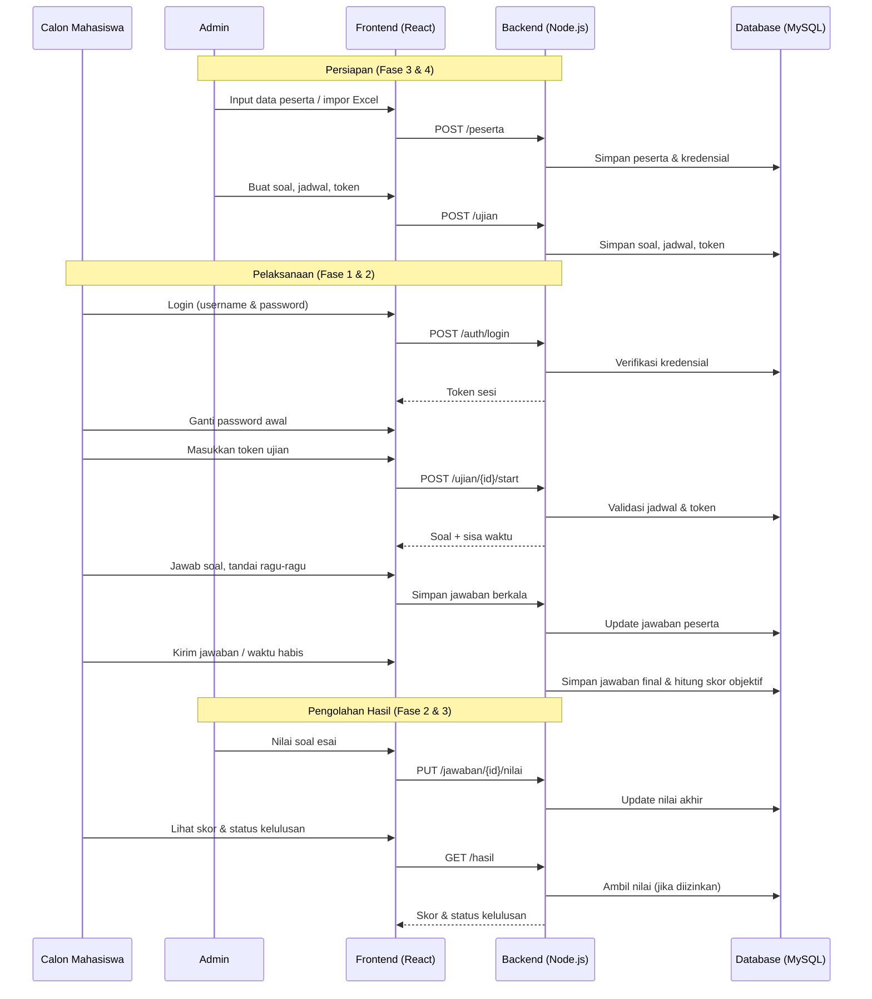
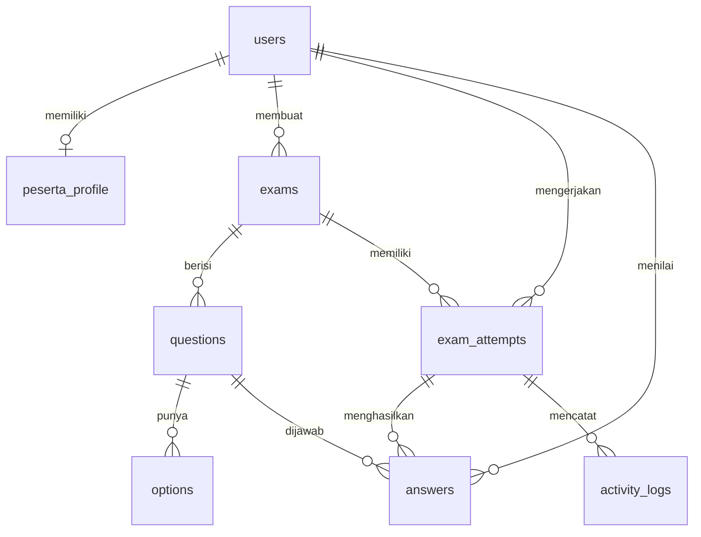

# PRD — Project Requirements Document

## 1. Overview

**Masalah yang Diselesaikan**
Proses ujian seleksi calon mahasiswa saat ini masih sering menggunakan kertas: boros biaya cetak, rawan kebocoran soal, lambat dalam penilaian, dan sulit memantau peserta secara langsung. Peserta juga harus datang ke lokasi tertentu untuk mengerjakan ujian.

**Tujuan Utama Aplikasi**
Membangun **Sistem Ujian Online** yang memungkinkan calon mahasiswa mengerjakan ujian dari rumah/mana saja, sementara Admin mengelola seluruh proses secara terpusat — mulai dari pendaftaran peserta, pembuatan bank soal, pengaturan jadwal & token, pengawasan ujian, sampai penerbitan hasil.

**Manfaat yang Diharapkan**
- Hemat biaya dan waktu (tanpa cetak kertas, penilaian otomatis untuk soal objektif).
- Keamanan lebih terjaga dengan token ujian dan akun yang dibuat terpusat oleh Admin.
- Hasil ujian lebih cepat keluar dan mudah direkap.
- Peserta bisa ujian dari rumah.

---

## 2. Requirements

**Persyaratan Fungsional**
- Sistem hanya memiliki **dua peran**: Admin dan Calon Mahasiswa.
- Peserta **tidak bisa mendaftar mandiri**; akun dibuat sepenuhnya oleh Admin.
- Admin dapat membuat peserta satu per satu maupun impor massal (Excel/CSV).
- Admin dapat mengimpor soal secara massal ke bank soal lewat berkas Excel/CSV memakai template standar yang disediakan sistem.
- Admin dapat membuat, mengatur, dan mendistribusikan kredensial (username & password).
- Setiap ujian dapat dilindungi **token** yang dibuat Admin.
- Soal mendukung tipe **pilihan ganda, esai, dan benar/salah**.
- Sistem mampu **menilai otomatis** soal objektif dan menyediakan penilaian manual untuk esai.
- Admin dapat mengatur bobot nilai, acak soal/opsi, serta kunci jawaban.
- Peserta dapat melihat skor & status kelulusan **hanya jika Admin mengizinkan**.

**Persyaratan Non-Fungsional**
- **Keamanan**: password disimpan terenkripsi, sesi login aman, perubahan password awal wajib.
- **Ketersediaan**: sistem harus stabil saat banyak peserta mengerjakan serentak.
- **Akurasi waktu**: timer ujian harus konsisten walau koneksi terputus (waktu tetap berjalan di server).
- **Kemudahan pakai**: antarmuka sederhana agar peserta non-teknis bisa langsung paham.
- **Audit**: aktivitas penting Admin dan peserta tercatat untuk keperluan pemantauan.

---

## 3. Core Features

Fitur di bawah ini **mengikuti kerangka roadmap yang telah disetujui**, dikelompokkan per fase.

### Fase 1 — Pengerjaan Ujian
- **Lembar Soal** — Menampilkan soal satu per satu lengkap dengan pilihan jawaban.
- **Timer Ujian** — Menghitung mundur sisa waktu dan otomatis mengumpulkan jawaban saat waktu habis.
- **Tanda Ragu-ragu** — Menandai soal yang belum yakin agar bisa dicek kembali sebelum dikumpulkan.
- **Navigasi Soal** — Daftar nomor soal untuk melompat ke soal lain dan melihat status sudah/belum dijawab.
- **Kirim Jawaban** — Mengumpulkan seluruh jawaban dengan konfirmasi sebelum benar-benar terkirim.

### Fase 2 — Jadwal & Token Ujian, Hasil Ujian
- **Jadwal Ujian Saya** — Menampilkan daftar ujian yang harus diikuti beserta tanggal dan waktunya.
- **Petunjuk Pengerjaan** — Menjelaskan aturan dan tata cara sebelum ujian dimulai.
- **Token Masuk Ujian** — Memasukkan token dari Admin sebagai syarat membuka soal.
- **Atur Jadwal & Token** — Admin menentukan jadwal, durasi, dan token tiap ujian.
- **Skor Akhir** — Menampilkan nilai yang diperoleh peserta.
- **Status Kelulusan** — Menunjukkan peserta lulus atau tidak lulus sesuai nilai kelulusan.
- **Rincian Jawaban** — Menampilkan jawaban peserta beserta kunci jawaban bila diizinkan.
- **Pengaturan Tampil Hasil** — Admin menentukan apakah hasil ujian boleh dilihat peserta.

### Fase 3 — Bank Soal, Pengawasan Ujian, Penilaian & Laporan
- **Tambah & Ubah Soal** — Membuat soal pilihan ganda, esai, atau benar/salah beserta pilihan jawabannya.
- **Kunci Jawaban & Bobot** — Menentukan jawaban benar dan besaran nilai tiap soal.
- **Acak Soal & Opsi** — Mengatur urutan soal dan pilihan jawaban diacak antar peserta.
- **Pratinjau Soal** — Melihat tampilan soal seperti yang akan dilihat peserta.
- **Impor Soal** — Memasukkan banyak soal sekaligus ke bank soal lewat berkas Excel/CSV memakai template standar, lengkap dengan validasi baris dan pratinjau sebelum disimpan.

### Template Impor Soal (Excel/CSV)

Sistem menyediakan berkas contoh yang bisa diunduh Admin dari panel **Bank Soal** (tombol "Unduh Template"), sehingga Admin tinggal mengisi sesuai kolom yang sama. Aturan kolom:

| Kolom | Wajib | Keterangan |
|---|---|---|
| `tipe_soal` | Ya | `pilihan_ganda`, `esai`, atau `benar_salah` |
| `teks_soal` | Ya | Isi pertanyaan |
| `opsi_a` | Ya (khusus pilihan_ganda) | Teks pilihan A |
| `opsi_b` | Ya (khusus pilihan_ganda) | Teks pilihan B |
| `opsi_c` | Tidak | Teks pilihan C (boleh dikosongkan) |
| `opsi_d` | Tidak | Teks pilihan D (boleh dikosongkan) |
| `opsi_e` | Tidak | Teks pilihan E (boleh dikosongkan) |
| `kunci_jawaban` | Ya | PG: `A`/`B`/`C`/`D`/`E`; benar_salah: `benar`/`salah`; esai: dikosongkan (dinilai manual) |
| `bobot` | Ya | Angka bobot nilai soal |
| `pembahasan` | Tidak | Umpan balik/pembahasan jawaban |
| `acak_opsi` | Tidak | `ya`/`tidak`, default `tidak` |

**Baris contoh:**

| tipe_soal | teks_soal | opsi_a | opsi_b | opsi_c | opsi_d | opsi_e | kunci_jawaban | bobot | pembahasan | acak_opsi |
|---|---|---|---|---|---|---|---|---|---|---|
| pilihan_ganda | Ibu kota Indonesia adalah | Jakarta | Bandung | Surabaya | Medan |  | A | 1 | Jakarta adalah ibu kota Indonesia | tidak |
| benar_salah | 2 + 2 = 4 |  |  |  |  |  | benar | 1 |  | tidak |
| esai | Jelaskan penyebab perubahan iklim |  |  |  |  |  |  | 5 |  | tidak |

**Perilaku impor:** saat unggah, sistem memvalidasi tiap baris, menampilkan pratinjau beserta daftar baris yang gagal (dengan alasan), lalu menyimpan semua baris valid ke bank soal saat Admin menekan **Simpan**. Soal hasil impor masuk sebagai soal `planned` yang bisa diubah lewat **Tambah & Ubah Soal**.
- **Pantau Peserta Langsung** — Melihat siapa saja yang sedang mengerjakan ujian saat itu.
- **Status Pengerjaan** — Mengetahui peserta yang belum mulai, sedang mengerjakan, atau sudah selesai.
- **Peringatan Kendala** — Memberi tanda bila peserta keluar halaman ujian atau koneksinya terputus.
- **Penilaian Otomatis** — Soal pilihan ganda dan benar/salah langsung dinilai saat peserta selesai.
- **Penilaian Esai** — Admin memeriksa dan memberi nilai jawaban esai peserta.
- **Rekap Nilai** — Melihat daftar nilai seluruh peserta dalam satu tampilan.
- **Unduh Laporan** — Mengunduh laporan hasil ujian dalam bentuk berkas untuk arsip.

### Fase 4 — Manajemen Peserta, Login & Akun Saya
- **Tambah Peserta** — Mendaftarkan satu calon mahasiswa beserta datanya.
- **Impor Massal** — Memasukkan banyak peserta sekaligus lewat berkas Excel atau CSV.
- **Kirim Kredensial** — Membuat username dan password lalu membagikannya ke peserta.
- **Atur Status Akun** — Mengaktifkan, menonaktifkan, atau mereset kata sandi akun peserta.
- **Masuk Aplikasi** — Login memakai username dan password yang diberikan Admin.
- **Ganti Password Awal** — Mengubah kata sandi bawaan saat pertama kali masuk.
- **Bantuan Lupa Password** — Meminta Admin mereset kata sandi bila peserta tidak bisa masuk.
- **Keluar Akun** — Keluar dari aplikasi dengan aman setelah selesai digunakan.

---

## 4. User Flow

**A. Admin — Menyiapkan Ujian**
1. Admin login ke panel admin.
2. Admin menambahkan peserta (satu per satu atau impor Excel/CSV).
3. Sistem membuat kredensial (username & password); Admin mendistribusikannya.
4. Admin menyusun bank soal (pilihan ganda, esai, benar/salah) beserta kunci & bobot.
5. Admin membuat jadwal ujian, durasi, dan **token**.
6. Admin menentukan apakah hasil boleh dilihat peserta atau tidak.

**B. Calon Mahasiswa — Mengerjakan Ujian**
1. Peserta login memakai username & password dari Admin.
2. Saat pertama kali masuk, peserta **wajib mengganti password awal**.
3. Peserta melihat **Jadwal Ujian Saya** dan membaca Petunjuk Pengerjaan.
4. Saat waktunya tiba, peserta memasukkan **token** untuk membuka soal.
5. Peserta mengerjakan soal dengan **timer** berjalan.
6. Peserta bisa menandai soal **ragu-ragu** dan berpindah soal via **navigasi soal**.
7. Peserta menekan **Kirim Jawaban** dan mengonfirmasi.
8. Jika diizinkan, peserta melihat **skor akhir** dan **status kelulusan**.

**C. Admin — Setelah Ujian**
1. Admin memantau peserta secara real-time selama ujian (status pengerjaan & peringatan kendala).
2. Soal objektif dinilai otomatis; soal esai dinilai manual oleh Admin.
3. Admin melihat **rekap nilai** dan mengunduh **laporan hasil ujian**.

---

## 5. Architecture

Sistem dibangun dengan arsitektur **client-server** tiga lapis:

- **Frontend (React)** — Antarmuka Admin & Peserta, berkomunikasi ke backend lewat REST API.
- **Backend (Node.js + Express)** — Menangani autentikasi, manajemen soal/peserta, penilaian, timer, dan token ujian.
- **Database (MySQL)** — Menyimpan data pengguna, soal, jadwal, jawaban, dan nilai.
- **WebSocket / Polling** — Untuk memantau peserta secara real-time.

---

## 6. Database Schema

Berikut tabel-tabel utama yang dibutuhkan sistem.

**Tabel `users`** — Menyimpan akun Admin dan peserta.
- `id` (INT, PK)
- `username` (VARCHAR, unik)
- `password_hash` (VARCHAR)
- `role` (ENUM: admin/peserta)
- `must_change_password` (BOOLEAN)
- `status` (ENUM: aktif/nonaktif)
- `created_at` (DATETIME)

**Tabel `peserta_profile`** — Data pendaftaran calon mahasiswa.
- `id` (INT, PK)
- `user_id` (INT, FK → users.id)
- `nama_lengkap` (VARCHAR)
- `email` (VARCHAR)
- `no_hp` (VARCHAR)
- `asal_sekolah` (VARCHAR)

**Tabel `exams`** — Master ujian.
- `id` (INT, PK)
- `judul` (VARCHAR)
- `durasi_menit` (INT)
- `jadwal_mulai` (DATETIME)
- `jadwal_selesai` (DATETIME)
- `token` (VARCHAR)
- `tampilkan_hasil` (BOOLEAN)
- `nilai_kelulusan` (DECIMAL)
- `created_by` (INT, FK → users.id)

**Tabel `questions`** — Bank soal.
- `id` (INT, PK)
- `exam_id` (INT, FK → exams.id)
- `tipe` (ENUM: pilihan_ganda/esai/benar_salah)
- `teks_soal` (TEXT)
- `kunci_jawaban` (TEXT)
- `bobot` (DECIMAL)
- `acak_opsi` (BOOLEAN)

**Tabel `options`** — Pilihan jawaban untuk soal objektif.
- `id` (INT, PK)
- `question_id` (INT, FK → questions.id)
- `label` (CHAR: A/B/C/D)
- `teks_opsi` (TEXT)
- `is_benar` (BOOLEAN)

**Tabel `exam_attempts`** — Sesi pengerjaan ujian oleh peserta.
- `id` (INT, PK)
- `exam_id` (INT, FK → exams.id)
- `user_id` (INT, FK → users.id)
- `waktu_mulai` (DATETIME)
- `waktu_selesai` (DATETIME)
- `status` (ENUM: belum_mulai/sedang_mengerjakan/selesai)
- `skor_total` (DECIMAL)
- `status_kelulusan` (ENUM: lulus/tidak_lulus/belum)

**Tabel `answers`** — Jawaban peserta per soal.
- `id` (INT, PK)
- `attempt_id` (INT, FK → exam_attempts.id)
- `question_id` (INT, FK → questions.id)
- `jawaban` (TEXT)
- `is_ragu` (BOOLEAN)
- `nilai` (DECIMAL)
- `dinilai_oleh` (INT, FK → users.id, nullable)

**Tabel `activity_logs`** — Pemantauan aktivitas peserta saat ujian.
- `id` (INT, PK)
- `attempt_id` (INT, FK → exam_attempts.id)
- `event` (VARCHAR: mulai/jawab/keluar_halaman/reconnect/submit)
- `timestamp` (DATETIME)

---

## 7. Tech Stack

Sesuai preferensi user:

| Lapisan | Teknologi |
|---|---|
| **Frontend** | React (dengan Vite) + React Router, Tailwind CSS untuk styling, shadcn/ui untuk komponen antarmuka |
| **Backend** | Node.js + Express (REST API) |
| **Autentikasi** | JWT (JSON Web Token) + bcrypt untuk hashing password |
| **Database** | MySQL + Prisma ORM sebagai penghubung data |
| **Real-time (pengawasan)** | Socket.IO (WebSocket) untuk memantau peserta secara langsung |
| **Penyimpanan file** | Penyimpanan lokal/S3 untuk file impor Excel/CSV & laporan hasil |
| **Deployment** | Rekomendasi: **Frontend → Vercel**, **Backend → Railway**, **Database → Railway MySQL Plugin** (mudah, hemat biaya, cocok untuk skala MVP) |

**Catatan tambahan:** jika ingin seluruhnya dalam satu server, alternatifnya deploy Frontend + Backend + MySQL di satu VPS (mis. DigitalOcean/VPS lokal) menggunakan Docker Compose.